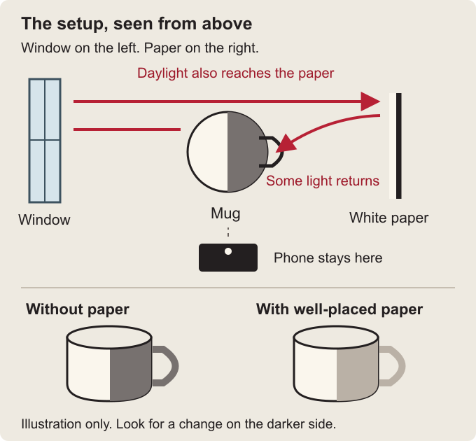
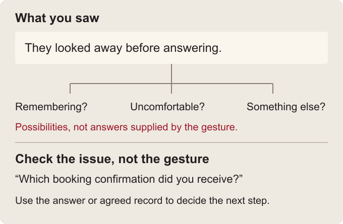

# Lesson rewrite samples for approval

**Historical approval samples.** The owner approved this direction on 25 October 2026. The illustrated rewrite now uses the teaching contract in [TEACHING.md](TEACHING.md). The comparisons below preserve the proposal as reviewed, rather than describing the app's current state.

The current collection forces each explanation into roughly 70-110 words. That often compresses away the setup, definitions, and worked example a beginner needs. The result can be technically defensible yet hard to learn from.

The proposed unit is **one idea learned**, not **one minute filled**. Use as much explanation as the idea needs, usually a few minutes of reading, with practice time stated separately. These three samples are not a mandatory template for every subject.

What changes:

- Start with a situation before introducing the term.
- Explain why something happens, not just what rule to follow.
- Use annotated pictures for spatial or visible ideas; use actual dialogue or worked notes when those explain better than a photograph.
- Give a guided first attempt, what to look for, and a fallback if it does not work.
- Replace obvious definition quizzes with a new situation that checks whether the idea transfers. “Not sure” should lead back to the example, not lose points.
- Keep sources and limits available without making every paragraph read like a disclaimer.

The two diagrams below are original explanatory drawings, not photographs, film stills, or measured before/after results. They can stay available offline. Actual photographic comparisons would need matched lighting/camera conditions and permission to bundle the images. Decorative pictures would not solve the teaching problem.

## Sample 1: Phone filmmaking

### Existing lesson, unchanged

**Bounce daylight into a shadow** from [the cinema collection](../src/data/cinema.ts#L672-L691).

> A pale surface can return some light toward the shadow side of a subject. Near a window, hold an existing sheet of white paper opposite the bright side of a cup. Adjust its angle until the shadow becomes more readable. The effect depends on surface size, distance, angle, and the available light.
>
> Lock exposure if your video mode allows it so automatic brightening does not disguise the comparison. Colored paper can introduce a color cast, and a tiny sheet far away can have little effect. This drill uses daylight only. Keep paper away from bulbs, heaters, vents, and any other heat source.

**Current “Put to use”**

> Spend 6 minutes recording a cup beside a window with no bounce, then with a white notebook page held near its shadow side. Keep the phone position fixed and exposure locked if supported. Compare the handle detail, not just overall brightness.

**Current “Make it stick”**

> Why can white paper brighten the shadow side of a cup?

The correct option repeats the explanation: it reflects existing light. That checks recognition, but not whether you know where to put the paper or what change to look for.

### Proposed lesson

## Your shot is too dark on one side. Try a sheet of paper.

**What you will learn:** brighten a subject's darker side without buying a light or brightening the whole picture.

### Start with something you have seen

You put a mug beside a window and point your phone at it. The side facing the window looks clear. The other side is so dark that the handle is difficult to see.

Your first instinct is to brighten the whole picture in an editor. The handle becomes easier to see, but the already-bright side also gets brighter. You wanted to change one part of the lighting, not everything in the picture.

That is where a white sheet of paper can help.

### Why paper can change the picture

The window sends light toward the mug. The side turned away from the window receives less direct light.

White paper reflects some of the light that lands on it. Hold it beside the mug's darker side, facing back toward the mug, where daylight can also reach the page. Some of that light returns toward the dark side.

The paper is not a lamp. It redirects light that is already in the room. Filmmakers call this **bounce**, and the returned light helps **fill** the shadow.

**Read the diagram:** leave the mug and phone where they are. The paper goes on the opposite side from the window, not between the window and mug. You are changing the light arriving at the mug before the camera records it.

### Try it once

You need your phone, a mug, daylight, and a white notebook page. Allow about 5-8 minutes for experimenting, separate from reading.

1. Put the mug on a stable table near a window. Turn its handle toward the darker side so you have one detail to inspect.
2. Support your phone safely. Make a short clip without the paper.
3. Keep the phone and mug still. Hold the page roughly a handspan from the mug's darker side, with its white face toward the mug. This is a starting position, not an exact measurement.
4. Slowly change the page's angle. Watch the handle rather than the whole screen. Record the position that makes it easier to see.
5. Remove the page and compare again. **Can you see more of the handle with the page, while the window-facing side changes less?**

If little changes, move the page closer or try a larger white page. Keep it clear of the main path from window to mug. The effect can be subtle in a room that already has pale walls reflecting light.

If the entire picture brightens and darkens, the phone may be adjusting automatically. If your camera offers exposure lock, use it: this holds the camera's brightness decision steady. Without it, compare what you can see directly and keep your conclusion modest. Nothing needs to be installed or bought. Use daylight only; keep paper away from heat.

### Now make a choice

You are filming a friend beside the same window. Their left cheek looks good, but their right eye disappears into shadow. You want to reveal that eye without making the bright cheek much brighter.

**Where would you first try the white page, and why?** Pause before opening the answer.

See the reasoning

Try it on your friend's darker, right-hand side, outside the frame, facing toward them and catching some window light. You are trying to send light into the shadow. Raising the camera's exposure instead changes the recording more broadly. The exact position still needs testing; the page is not guaranteed to work equally well in every room.

**The idea to keep:** before turning up the whole image, ask whether you can bring light to the part you cannot see.

**Sources and scope:** [StudioBinder's explanation of fill and bounce](https://www.studiobinder.com/blog/what-is-fill-light-photography-definition/) and [Apple's model-specific camera controls](https://support.apple.com/guide/iphone/set-up-your-shot-iph3dc593597/ios). The setup is our beginner exercise. It does not require the equipment, fixed lighting ratios, or mood claims discussed elsewhere in the commercial guide.

## Sample 2: Understanding people

### Existing lesson, unchanged

**Do not turn body language into a lie detector** from [the observation collection](../src/data/fieldcraft.ts#L202-L221).

> A person looks away while explaining a missing booking. Research reviews do not support a dependable visual checklist that identifies lies from gaze, posture, or fidgeting. Those behaviors have many possible causes, including discomfort, concentration, and the demands of the conversation itself.
>
> Check the booking through an agreed record or ask which confirmation they received. Do not create stressful surprise tests, demand eye contact, or combine several weak cues into a confident accusation. Changes from familiar behavior also need context; a personal baseline does not turn movement into a truth meter.

**Current “Put to use”**

> Replace one imagined lie cue with a neutral question about a checkable detail, such as the booking date.

**Current “Make it stick”**

> Someone avoids eye contact while answering. What follows?

The lesson mostly lists what not to conclude. It needs to show what a useful conversation actually sounds like.

### Proposed lesson

## They looked away. What do you actually know?

**What you will learn:** use an observation to choose a better question, without pretending it reveals another person's thoughts.

### An ordinary misunderstanding

You and a friend arrive at a cafe. The staff cannot find the booking. You ask your friend whether they booked the table. They look away, pause, and say, “I did it yesterday.”

Your first thought is: “They are making this up.”

That thought is understandable, but notice the extra step you just took. You saw a pause and a change in gaze. You added an explanation: dishonesty.

### Separate the movement from its meaning

Looking away is an **observation**, something you can describe. “They are lying” is an **interpretation**, a possible explanation you have supplied.

The same visible action can happen while someone recalls a detail, feels uncomfortable, or simply finds it easier to speak without steady eye contact. Dishonesty is also possible. The point is that the movement does not select one explanation for you.

So you do not need to ignore the movement. You need to avoid treating it as a verdict.

### What to say instead

An accusation would be: “You cannot even look at me. You forgot, didn't you?” Now the conversation is about defending character, not finding the table.

A useful question is: **“Which confirmation did you receive? Shall we check the date and branch?”**

Suppose your friend opens the confirmation and it shows tomorrow's date. You have found a specific problem you can act on. You have not proved what the earlier glance meant, and you do not need to.

If there is no confirmation, keep that uncertainty. No message is not automatic proof of a lie either. Ask how the booking was made, then decide what to do next using the information available.

### Try it without studying strangers

Use this fictional sentence first: **“My teammate answered in a flat voice, so they disliked my idea.”**

1. Write only what was observable: “Their voice sounded flat to me.”
2. Write two possible explanations without selecting a winner: perhaps they disagree; perhaps they are tired or concentrating.
3. Replace the conclusion with a question about the idea: **“What part would you change?”**
4. For this fictional exercise, stop after drafting your question. In a real conversation, listen to the answer and discuss any specific problem instead of trying to decode the person's face.

You have done the exercise when your next action collects relevant information rather than demands that someone prove a feeling or motive. You do not need to record private behavior, force eye contact, or get the person to reveal more than they want.

### Try the idea in a different setting

A colleague folds their arms while you explain a proposal. Later they ask detailed questions about it.

**Would you assume rejection, assume enthusiasm, or leave the attitude uncertain and discuss their questions? What evidence would change your view?**

See the reasoning

Leave the attitude uncertain. Questions give you something concrete to discuss, but they can express interest, confusion, or criticism. Ask which concerns remain. A specific objection is evidence of that objection, not proof of a whole personality or hidden motive.

**The skill to keep:** good observation improves your next question. It does not make you certain sooner.

**Sources and scope:** [APA's overview of deception research](https://www.apa.org/monitor/2016/03/deception) and [National Autistic Society communication guidance](https://www.autism.org.uk/advice-and-guidance/topics/communication/tips). The cafe and workplace dialogues are fictional teaching examples, not a validated lie-detection procedure.

## Sample 3: Everyday attention

### Existing lesson, unchanged

**Leave a restart note before switching tasks** from [the psychology collection](../src/data/mind-thinking.ts#L218-L239).

> You leave a packet capture to answer a teammate and return unable to remember which exchange mattered. Research on attention residue describes how thoughts about unfinished work can persist after a switch. Merely displaying the next task does not guarantee that attention follows it.
>
> Before a planned switch, note the last observation, the unanswered question, and the next read-only check. This is a practical handoff heuristic, not a promise to eliminate switching costs. Keep it short enough to read before reopening the capture; a full incident report defeats the purpose.

**Current “Put to use”**

> Write a three-line restart note before your next planned task switch today.

**Current “Make it stick”**

> Which note best supports restarting an interrupted investigation?

The correct option is the same three-part phrase from the explanation. There is no completed example to show what those three lines look like.

### Proposed lesson

## Leave yourself a starting point, not just an open tab.

**What you will learn:** make it easier to return to an interrupted task by saving the decision you were about to make.

### The moment this is for

You are editing a short phone video. You have compared two recordings, and you are about to fix an awkward transition between clips. Then a work call starts.

When you come back, the editor is still open. The clips are still there. But you cannot remember which recording you preferred or what looked wrong with the transition. You start watching everything again.

Keeping the app open saved the material. It did not save your reasoning.

### Give your future self a small handover

Before a planned interruption, leave three short lines:

| Line | Example from the video edit |
| --- | --- |
| **Done** | Chose recording 2; the mug stays sharp when the hand enters. |
| **Still deciding** | The cut to the hand feels late. |
| **First action when back** | Play the selected clip. Find the first moment the hand starts moving. Try joining the next clip there. |

You do not need the term “attention residue” to use this. The immediate purpose is simpler: make the task's current state visible instead of asking your memory to rebuild it.

The last line matters most. “Continue editing” makes you decide where to begin again. “Find the moment the hand starts moving” gives you an action you can take immediately.

### Compare a weak note and a usable one

**Weak:** “Fix video tomorrow.”

**Usable:** “Recording 2 selected. Unsure where to join the next clip. Start by watching the hand enter the selected clip.”

The second note is not a diary of everything you did. It keeps just enough of the unfinished decision to restart. If writing it becomes another project, shorten it.

### Try it today

Pick a task you can pause safely: a drawing, a draft message, a video edit, or nonurgent work. Do not interrupt something safety-critical just to test this.

1. Before you leave, write **Done / Still deciding / First action when back**.
2. Put the note where you will see it when you return, such as the document's top or a clearly named phone note. Do not copy private work material into this app.
3. Return after your normal break. Read the note and attempt only the first action.
4. Ask: **“Could I begin without reconstructing the whole task?”** If not, rewrite the last line to name something you can actually do.

Success here means the note gave you an entry point. It does not mean you suddenly felt focused or that interruptions stopped costing effort.

### What would you leave for yourself?

You pause while comparing two routes to a filming location. You have checked travel time, but not whether buses still run after the shoot finishes.

**Write the “First action when back” line.**

Compare with an example

“Check the return-bus timetable for our expected finish time on each route.”

That tells you what information is missing and where the comparison resumes. “Finish travel planning” is still an intention rather than a starting action.

**The idea to keep:** save the next move, not a command to concentrate harder.

**Sources and scope:** [Leroy's research on attention residue](https://doi.org/10.1016/j.obhdp.2009.04.002) provides background on unfinished work and switching. The three-line format and video-edit example are practical teaching suggestions, not a claim that this exact worksheet was tested or guarantees productivity. Losing the task's context and continuing to think about another task are related problems, not identical definitions.

## Approval question

Does this teach clearly enough on the first read, particularly the connection between the example, the exercise, and the final question? Is this amount of detail comfortable, or should one idea span several shorter screens?

Only after approval: revise a small pilot set, try it in the reader, then expand. Do not automatically apply this word count or the same headings to all 544 lessons. Keep a concise recap at the end for later review; do not mistake that recap for the original teaching.